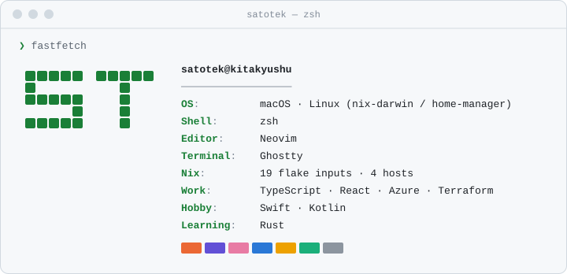
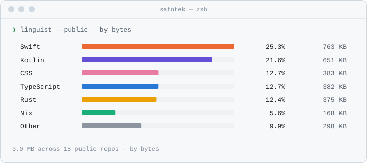
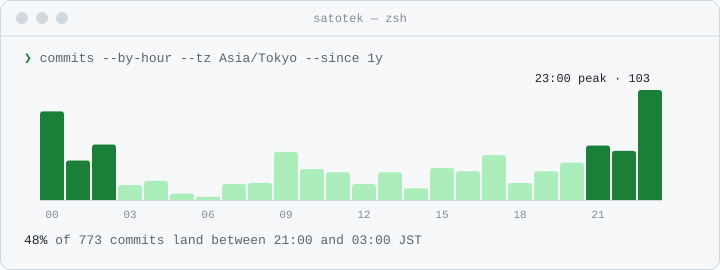

# Hi there 👋

I'm satotek.  
Software engineer based in Kitakyushu, Japan 🇯🇵  
Originally from Kanagawa.

  

  <picture>
    <source media="(prefers-color-scheme: dark)" srcset="assets/fetch-dark.svg" />
    
  </picture>

  Personal apps: <a href="https://github.com/satotek/screvia">screvia</a> (Swift) / <a href="https://github.com/satotek/cellscope">CellScope</a> (Kotlin) · Dotfiles: <a href="https://github.com/satotek/dotfiles">satotek/dotfiles</a>

  <picture>
    <source media="(prefers-color-scheme: dark)" srcset="assets/languages-dark.svg" />
    
  </picture>

  <picture>
    <source media="(prefers-color-scheme: dark)" srcset="assets/hours-dark.svg" />
    
  </picture>

